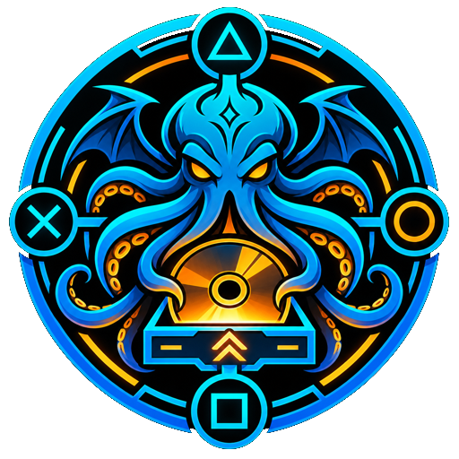

A PS5 game mounter. It finds games on the internal SSD, the M.2 drive and USB drives.

**Supported formats**: debug FPKG (`.pkg`), game folders (plain, or packed with zstd or LZ4) and
images as made by ShadowMount+'s tools or PS5 Dump Forge: `.exfat`, `.ffpkg` (UFS), `.ffpfs` (PFS) and `.ffpfsc`
(compressed PFS container); mounted read-only.
For large, demanding games, use the zstd pack format: it performs better than FPKG.

## How to

1. Download `kraken-mount.elf` from [Releases](https://github.com/quer3q/kraken-mount/releases)
   and send it to your jailbroken PS5 with the ELF loader (elfldr, port 9021) or payload-manager:
   `nc -w 3 <ps5-ip> 9021 < kraken-mount.elf`. ShadowMount+ must not be running: Kraken Mount waits
   until it stops. kstuff is not needed to start Kraken Mount, but a fake-signed game needs it to start; when such
   a game fails to start without it, Kraken Mount shows a notification.
2. Put each game in a scan root, or in a folder directly inside one (for example
   `/data/homebrew/rpg/<game>`; deeper folders are not scanned, and on a drive root only the root itself):
   - internal SSD: `/data/homebrew`, `/data/etaHEN/games`
   - M.2 or extended drive (`/mnt/ext0`, `/mnt/ext1`): `homebrew`, `etaHEN/games` or the drive root
   - USB drive (`/mnt/usb0` to `/mnt/usb7`): `homebrew`, `etaHEN/games` or the drive root
3. Each game gets a "<name> registered" notification and its own home-screen tile.

The web UI (port 8097, opened from the "Kraken Mount" home-screen tile) has the **Library** of games, the
**Install** tab, the **Hidden** and **Backports** screens and the settings.

Install to the console: FPKG games install from their game sheet in the Library (**Install**), and the **Install**
tab lists the patch and DLC `.pkg` files from the scan roots; both hand the `.pkg` to the console's installer. The
Install tab shows while something is queued, installable or kept, with the queue and the results. A patch needs its
game installed. This
needs fpkg-enable and ppr-patch loaded besides kstuff. With the `install_delete_source` setting (the Install tab's
checkbox, off by default) the source `.pkg` is deleted once the install is done. Games installed on the console
(`/user/app`, extended storage) show in the Library too; Kraken Mount never mounts, hides or deletes them.

Backports: put the files in a folder `backports/<TITLE_ID>*` in the first scan root (by default
`/data/homebrew/backports`); setting `backports` (on by default) applies them. A game installed on the console
takes the whole backport too: its lib dir goes into the fakelib, and its other files are redirected into the game's
`/app0` at each launch through NSFS redirects (the install itself is not changed). The **Backports** screen lists these
folders with Delete. The **Hidden** screen lists the hidden games (the `exclude` setting) with Unhide.

Updates: at start Kraken Mount checks the latest release on GitHub. When a newer one is out, the
web UI shows "Kraken Mount <version> is available"; **Update** downloads it and sends it to elfldr
(port 9021), and the new copy takes over (close the running game first).

To keep it updated with [ps5-payload-manager](https://github.com/itsPLK/ps5-payload-manager), add
`https://github.com/quer3q/kraken-mount/releases/latest/download/payloads.json` as a custom
repository. Each published release carries that catalog (the `.elf` and its SHA-256, which the
manager checks on every download); `latest` is the newest release that is not a pre-release. The
in-UI **Update** does not change the manager's copy: if the manager loads Kraken Mount at boot, it
starts the version the manager last installed, so update it in the manager too.

[ampr-emu-ng](https://github.com/quer3q/ampr-emu-ng) comes bundled and is installed into
`/data/krakenmount/ampr/` at start. To run another build, put its `libSceAmpr.sprx` there; it is
kept until you delete it. For a game installed on the console, ampr-emu-ng is used only with the
`ampr_installed` setting (off by default); while it is off, the game's own `libSceAmpr.sprx` (the install's,
hidden at launch through NSFS, and its backport's) is kept out, so the system's runs.

A game that needs the DLC or PlayGo emulator and ships none gets the bundled one in its fakelib
(setting `add_emulators`, on by default); a game's own copy is kept, unless it is a known older
release of the bundled one, which is upgraded. The PlayGo stub can be turned off per game in the
game's details. Details:
[DLC emulator](docs/dlcemu.md), [PlayGo stub](docs/playgo.md).

Caches live in `/data/krakenmount/caches/<TITLE_ID>`, settings in
`/data/krakenmount/config.toml` and the log in `/data/krakenmount/kraken.log`.

To build it yourself: `ps5/build.sh` (needs Docker), output `target/ps5/kraken-mount.elf`.

## Thanks

- [drakmor/ShadowMountPlus](https://github.com/drakmor/ShadowMountPlus): home-screen
  registration, the fakelib sandbox overlay and backports are ported from it.
- [drakmor/dlc_emu](https://github.com/drakmor/dlc_emu): the bundled DLC emulator
  (`libSceAppContent.sprx`, `libSceNpEntitlementAccess.sprx`, `libSceGameUpdate.sprx`), added to a
  game's fakelib when the game has a `dlc_emu.ini` at its root; a known older release the game ships
  is upgraded, any other copy is kept.
- [drakmor/pgo_stub](https://github.com/drakmor/pgo_stub): the bundled PlayGo stub
  (`libScePlayGo.sprx`), added to a game's fakelib when its `eboot.bin` imports `libScePlayGo` and the
  game ships none.
- [ps5-payload-sdk](https://github.com/ps5-payload-dev/sdk): the PS5 toolchain.
- [quer3q/ps5-dump-forge](https://github.com/quer3q/ps5-dump-forge): the console install path
  (`ps5/installer.c`), the build setup, the self copy, the home-screen tile and the toasts.

## License

GPL-3.0-or-later (`LICENSE`). Third-party notices are in `THIRD_PARTY_NOTICES`.
